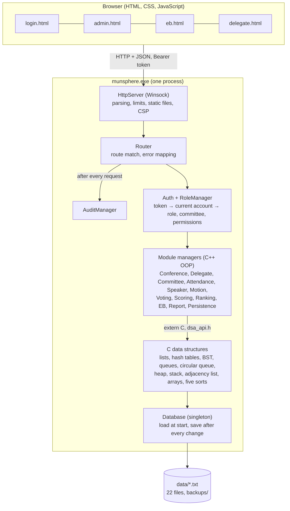

# MUNSphere architecture

## 1. The system at a glance



The same in text:

```
 Browser  ── HTTP/JSON ──►  HttpServer ─► Router ─► Auth/RoleManager ─► Managers (C++) ─► C structures ─► Database ─► data/*.txt
                                            └─► AuditManager (records every change)
```

**Where each kind of code lives**

| Layer | Decides | Never does |
|---|---|---|
| C (`*_dsa.c`) | *How* data is stored and found: structures, algorithms, file format | Business rules, permissions |
| C++ managers and classes | *Whether* an action is allowed and *what* it means | Store a second copy of any record |
| JavaScript | *How* it looks | Make a rule decision the server doesn't also enforce |

## 2. One request, end to end

Example: a delegate votes `yes`.

1. `fetch("POST /api/votes/V003/ballot", {choice:"yes"})` with the delegate's token.
2. `server.cpp` reads it (16 KB header and 1 MB body limits, 5 s timeout) into an
   `HttpRequest`.
3. The `Router` matches `/api/votes/:id/ballot` and calls the handler.
4. `Auth::require()` maps the token to an account ID and **re-reads the account**
   (still active? which role?). Nothing about identity comes from the browser.
5. `VotingManager::cast()`: the vote must be open; `requireSeated()` checks the
   delegate is placed in this committee and marked present (Module 4); the
   `Vote` class refuses an abstention on a procedural vote.
6. C: `ballot_cast()` searches the ballot array for a previous ballot (duplicate
   → 409), then appends.
7. `Database::save(Store::Votes)` writes `votes.txt` and `ballots.txt`
   atomically.
8. The router's observer gives the result to `AuditManager`, which appends
   *"D004, delegate, Cast ballot, id=V003, 200"* with its chained hash. The
   choice itself is never logged.
9. `{"ok":true,"data":{…}}` goes back. Any exception thrown on the way becomes a
   JSON error with the right status, and nothing is saved.

## 3. The C/C++ contract

`Shared/dsa_api.h` declares every C struct and function once, inside
`extern "C" { … }`, and is included by **both** sides.

* `extern "C"` turns off C++ name mangling so the linker can join C++ calls to
  C definitions.
* Because the C files include the same header, the compiler checks their
  definitions against the declarations. Hand-copied declarations in each `.cpp`
  would not be checked: a mismatch would link and then corrupt data.
* **Ownership:** C allocates and frees every node. C++ receives copies of
  records, never pointers into a structure, so no C++ object can be left
  pointing at freed memory.
* **Windows headers come last.** `<windows.h>` defines many short macros
  (`REG_NONE`, `min`, `max`, `ERROR`, `DELETE`…) that would silently rewrite our
  declarations. Files include `dsa_api.h` first and define `NOMINMAX`; constants
  use names Windows doesn't (`REGISTRATION_NONE`, not `REG_NONE`).
* **Errors:** C returns a `DsaStatus` (`DSA_ERR_DUPLICATE`, `NOT_FOUND`, `FULL`,
  …); C++ turns it into an HTTP status.

## 4. One shared data store

Each record exists once, in its module's C structure (`static` globals private
to that `.c` file). Other modules refer to records by ID. A committee roster,
for example, is built from the delegate store on demand, not copied.

**Files.** One text file per store in `data/`:

```
#MUNSPHERE|sessions|1
SES001|COM001|Opening session|2026-12-01|10:00|12:00|2
```

A header with kind and version; `|`-separated fields; `\`, `|` and newlines
escaped so any text round-trips. Saving writes `file.tmp` and renames it over
`file`, so a crash mid-save leaves the old file intact. Loading builds new
structures first and swaps them in only if the file is valid; a file with a wrong
header stops the server **without being touched**. Text was chosen over binary
`fwrite` so files are readable in Notepad and independent of struct padding.

**Every change is saved immediately**, so stopping the server never loses data.
The audit log is the exception in format, not safety: it is append-only.

## 5. Security design

| Concern | Design |
|---|---|
| Passwords | PBKDF2-HMAC-SHA256, 60,000 iterations, random 16-byte salt, stored as `pbkdf2-sha256$iter$salt$hash`; SHA-256, HMAC and PBKDF2 written in `Auth.cpp` and checked against Python's `hashlib` (including RFC 7914's vector); constant-time comparison |
| Sessions | 256-bit random token (`BCryptGenRandom`), 8-hour sliding expiry, kept in server memory |
| Login | Lockout after 5 failures; unknown IDs hashed against a dummy so timing doesn't reveal which exist; reset requests answer the same for every ID |
| Identity | Every request re-reads the account and EB assignment: revocation, transfer and permission changes apply at once |
| Authorization | Each handler calls one `RoleManager` check; EB access needs both the right committee and the permission bit; `test_authz.cpp` verifies all 130 routes for six identities |
| Separation of duties | EB writes marks, Admin approves; Admin never writes marks, EB never approves |
| Browser | Content-Security-Policy `default-src 'self'` (no inline script or style); every value inserted into HTML is escaped; downloads fetched with the token, never with a token in the URL |
| Audit | Every change, including refused attempts, in a SHA-256 hash chain; request bodies never logged |
| Data | Atomic writes; corrupt files never overwritten; backups verified against a SHA-256 manifest before restoring |

## 6. Design decisions and trade-offs

| Decision | Why | Cost |
|---|---|---|
| Single-threaded server | No concurrent access to the C structures, so no locks and no races | One slow request delays others; at conference scale requests take well under a millisecond, except login (~50 ms of PBKDF2) |
| Save after every change | Nothing is ever lost on Ctrl+C or power loss | Whole-file rewrites; fine for thousands of records |
| Tokens in memory | Nothing secret on disk; simple | A restart signs everyone out |
| Hash table + BST for delegates | O(1) lookup by ID and an alphabetical order without sorting | The BST can become unbalanced (height is shown in the analytics) |
| Polling every 3 s for live pages | Works over plain HTTP with no extra libraries | Up to 3 s delay; a few requests per minute per open page |
| One audit hook in the router | Every module is covered without touching it | The label table must name new routes (unnamed ones still log as `METHOD /route`) |
| Restore keeps the audit log | History must never be rewritten | The log can describe changes a restore later undid, which is correct |
| JSON, SHA-256, HTTP written in-house | Nothing to install; everything is explainable | More code to test (hence 2,269 checks) |
| Default bind to 127.0.0.1 | Safe default | Use `--host 0.0.0.0` deliberately for a network |

## 7. Testing strategy

* **C suites** test each structure alone: empty, single, many, duplicates,
  boundaries (circular queue wrap-around, BST deletion cases, rehash threshold),
  persistence round trips, corrupt input, and 5,000-record runs. Sorting results
  are compared with the C library's `qsort`; comparison counts with the textbook
  formulas.
* **C++ suites** drive the real router and managers with real stores and files,
  one per phase of the project, including every rule in the specification.
* **The authorization matrix** enumerates the router's own route list, so an
  unclassified new endpoint fails the build of trust.
* **Sanitizers.** All suites run under AddressSanitizer and
  UndefinedBehaviorSanitizer; they caught a use-after-free in test code that a
  normal run would have missed.
* **Browser tests** (Chromium) exercised every workflow and every page for every
  role at desktop and phone widths. They found real defects that unit tests
  could not: stale edit dialogs, results vanishing on re-render, a shadowed
  variable on the landing page, and broken table markup.
* **What isn't automated here:** the Windows-only branches (Winsock,
  `MoveFileExA`, `BCryptGenRandom`, `run.bat`, the hidden password prompt) were
  written to the MinGW documentation and run on the target machine, not in this
  test environment.

## 8. Questions to prepare for the viva

**Linked lists, queues, stacks**
1. Why does deleting from a singly linked list need the previous node? What changes with a doubly linked list, and what does it cost?
2. Why are sessions sorted on insert rather than when listed? When would the opposite be better?
3. Why does a circular queue need `count` (or one empty slot) to tell full from empty?
4. What would go wrong if undo popped the stack without checking the motion's current status?

**Hash tables and trees**
5. What is the load factor after the 7th insert into an 8-bucket table, and why resize *before* inserting?
6. Why does rehashing keep inserts O(1) on average even though one rehash is O(n)?
7. In BST deletion with two children, why can't the in-order successor have a left child?
8. Why is the BST an index of keys rather than a second copy of each record?
9. When does the BST degrade to O(n), and what would prevent it?

**Heaps and sorting**
10. Why is a heap better than a sorted list for pending motions? Compare insert and take-top.
11. Why does selection sort always make n(n−1)/2 comparisons, even on sorted input?
12. Why does a total-order comparison let unstable sorts give the same ranking as stable ones?
13. Quick sort here takes n(n−1)/2 comparisons on sorted input. Why, and what pivot would fix it?
14. How does recursing into the smaller partition bound quick sort's stack depth?

**C and C++ together**
15. Why is `extern "C"` needed, and what linker error appears without it?
16. What goes wrong if C++ keeps a pointer into a C list node that is later freed?
17. Why declare everything once in `dsa_api.h` instead of in each `.cpp`?

**OOP**
18. `EBMember` is abstract. What stops `new EBMember(…)`, and how does the factory pick the subclass?
19. Where is polymorphism used at run time, and where is it compile-time (templates)?
20. Why does `Person` *have* a `User` instead of *being* one?
21. Why store a snapshot of the criteria in each marksheet rather than refer to the current criteria?

**Persistence and security**
22. Why write to a temporary file and rename, rather than write the file directly?
23. Why is the audit log appended line by line instead of rewritten through a temporary file?
24. Why does editing one old audit entry make every later entry fail verification?
25. Why must a restore never roll back the audit log?
26. Why does restore check every file's SHA-256 *before* copying anything?
27. Why does the round-trip check compare `delegates.txt` as a set of lines but `speeches.txt` byte for byte?
28. Why PBKDF2 with a salt rather than plain SHA-256 for passwords?
29. Why does `Auth::require()` re-read the account on every request?
30. Which rule stops an EB member approving their own marksheet, and where is it enforced?
31. Why must ownership be checked *before* state (the POI withdrawal fix)?
32. Why does the countdown use the server's time instead of the browser's?
33. How does the authorization test guarantee that a new endpoint can't be added without a permission decision?
